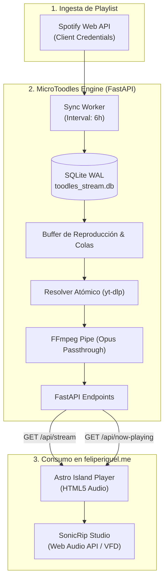

# MicroToodles 📻

Microservicio asíncrono en Python (FastAPI + Docker ARM64) diseñado para emitir un stream continuo de audio y metadatos en vivo a partir de una playlist de Spotify, alimentando la experiencia sonora y el laboratorio DSP de **[feliperiquel.me](https://feliperiquel.me)**.

Basado en la arquitectura de bajo consumo de CPU de **[Tooodles](https://github.com/Pipin333/Tooodles)**.

---

## 🏛️ Arquitectura del Sistema



---

## ⚡ Endpoints de la API

| Método | Endpoint | Descripción | Formato |
| :--- | :--- | :--- | :--- |
| `GET` | `/health` | Chequeo de salud del servicio y estado del worker | JSON |
| `GET` | `/api/now-playing` | Metadatos en tiempo real del tema actual, posición y duración | JSON |
| `GET` | `/api/stream` | Stream continuo de audio en chunks para reproductor web | `audio/ogg; codecs=opus` |
| `GET` | `/api/queue` | Lista de las próximas pistas encoladas | JSON |
| `GET` / `POST` | `/api/next-track` | Avanza a la siguiente pista de la playlist (Jukebox on-demand / Skip) | JSON |

---

## 🐳 Ejecución con Docker (1-Click Run)

El proyecto está 100% containerizado para arquitecturas `linux/amd64` y `linux/arm64` (Oracle Cloud / Raspberry Pi / Docker Desktop).

### 1. Clonar y configurar entorno
```bash
git clone https://github.com/Pipin333/microtoodles.git
cd microtoodles
cp .env.example .env
```

### 2. Configurar variables de entorno (`.env`)
```ini
SPOTIFY_CLIENT_ID=tu_client_id
SPOTIFY_CLIENT_SECRET=tu_client_secret
SPOTIFY_PLAYLIST_ID=tu_playlist_id_de_spotify
PORT=8080
HOST=0.0.0.0
CORS_ORIGIN=https://feliperiquel.me
DATABASE_PATH=toodles_stream.db
ADMIN_TOKEN=tu_token_de_admin
SYNC_INTERVAL_HOURS=6
FFMPEG_BIN=ffmpeg
ENV=production
```

### 3. Levantar con Docker Compose
```bash
docker compose up --build -d
```
El servicio quedará disponible de inmediato en `http://localhost:8080`.

---

## 🛠️ Desarrollo Local (Sin Docker)

Requisitos previos: **Python 3.12+** y binario de **FFmpeg** instalado en el sistema.

```bash
# Crear y activar entorno virtual
python -m venv .venv
source .venv/bin/activate  # En Windows: .venv\Scripts\activate

# Instalar dependencias
pip install -r requirements.txt

# Ejecutar suite de pruebas unitarias y de integración
pytest -v

# Ejecutar servidor de desarrollo
uvicorn main:app --host 0.0.0.0 --port 8080 --reload
```

---

## 📄 Licencia y Autor
Diseñado y desarrollado por **Felipe Riquelme (@Pipin333)** bajo Licencia MIT.
